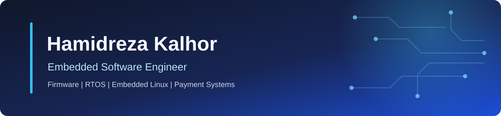

I am an Embedded Software Engineer with 6+ years of experience building production systems across payment terminals, embedded Linux and Android, access control, industrial automation, and IoT.

I work close to the hardware - from low-level firmware and board bring-up to communication protocols, software architecture, diagnostics, and reliable operation in the field.

## Engineering Focus

- **Firmware & RTOS:** Embedded C/C++, real-time systems, device drivers, hardware abstraction, and memory-conscious design
- **Embedded Linux & Android:** Custom kernels, Yocto, Buildroot, device trees, board support, and peripheral integration
- **Connected Devices:** TCP/IP, HTTP/HTTPS, internal web servers, remote updates, and device telemetry
- **Industrial Communication:** Modbus, CANopen, RS485, RS422, RS232, Wiegand, and RFID
- **Hardware Platforms:** ARM-based SoCs, STM32, ESP32, AVR, Holtek, and STM8

## Experience Highlights

- Develop C firmware for production payment terminals, with an emphasis on reliability, diagnostics, networking, and safe update flows.
- Built custom embedded Linux and Android platforms for Rockchip-based industrial boards, including kernel, device-tree, display, touch, USB, serial, and audio integration.
- Developed industrial controllers for smart locks, combi ovens, sensor nodes, robotic parking systems, and environmental control devices.
- Designed networked access-control systems with RFID readers, secure TCP/IP communication, anti-tailgating logic, and robust field interfaces.
- Implemented PID-based temperature control, event logging, health-monitoring telemetry, and web-connected device platforms.
- Applied DFM/DFT, EMI/ESD-aware design, layered architecture, design patterns, and Agile development in production projects.

## Technology Stack

### Languages & Core Tools

### Platforms & Systems

### Protocols & Interfaces

## Education & Recognition

### 🎓 Education

**B.Sc. in Energy Engineering**

*Amirkabir University of Technology (Tehran Polytechnic)*

### 🏆 Awards

- 🥇 **Best Technical Team** — RoboCup Asia · 2019
- 🥇 **Best Technical Team** — IranOpen · 2018

## Engineering Principles

- Keep platform-specific behavior isolated and explicit.
- Prefer simple, testable solutions over unnecessary abstraction.
- Treat real-device behavior as the final source of truth.
- Design for constrained resources, predictable execution, and safe recovery.

## Contact

